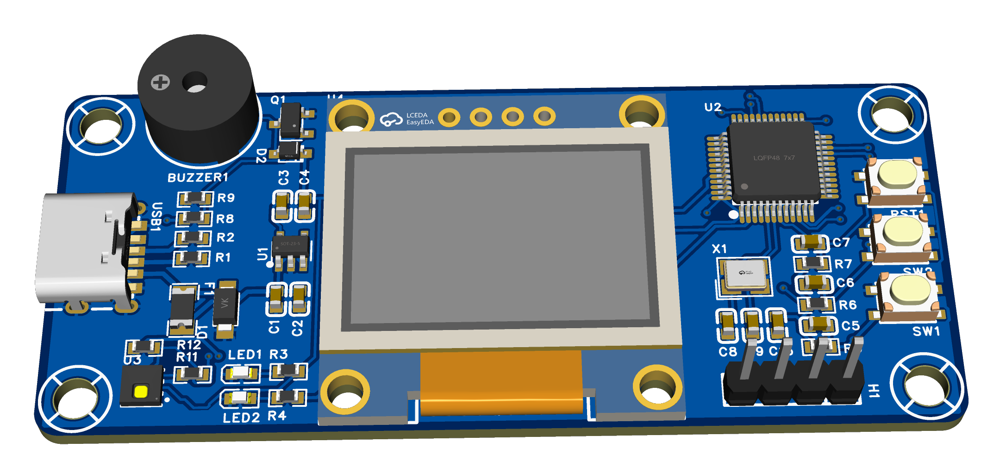
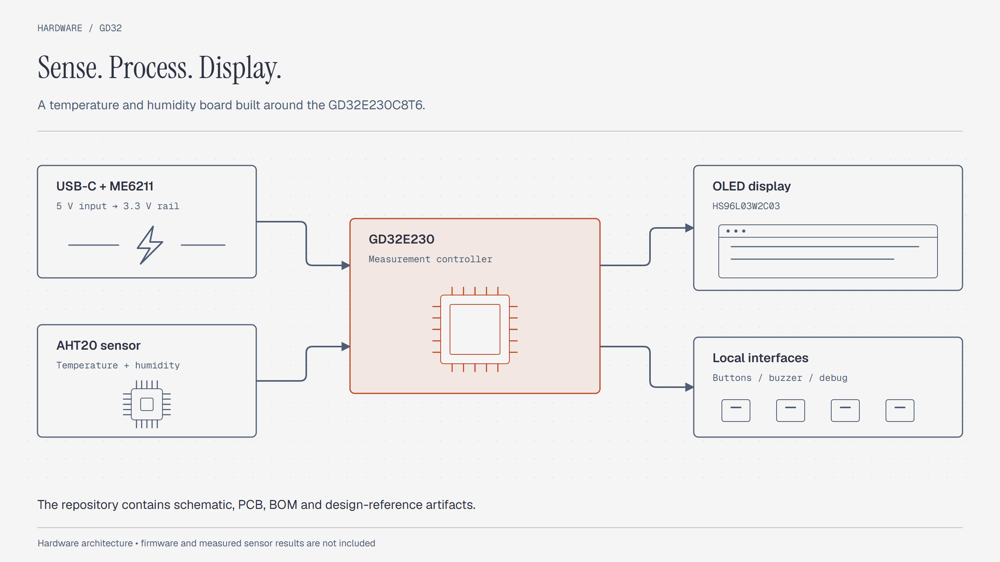
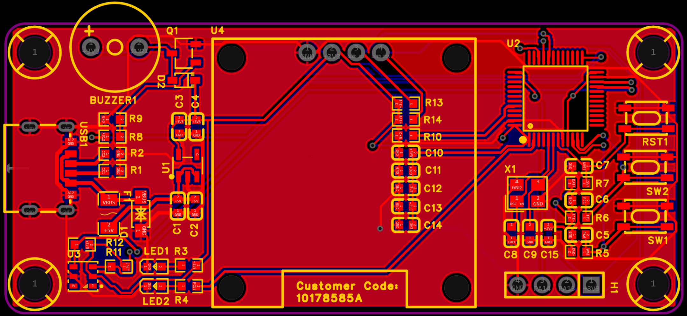
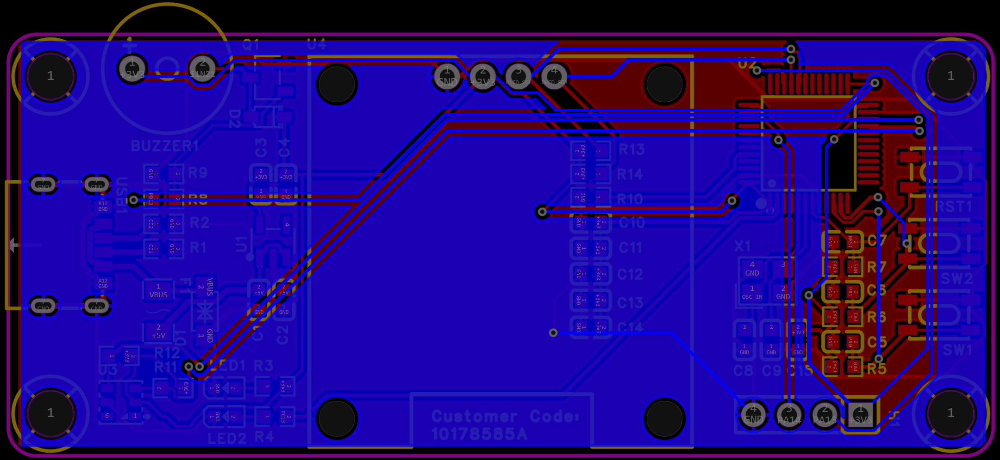

# GD32 Temperature and Humidity Board

An EasyEDA Pro hardware design for temperature and humidity measurement. The board combines a GD32E230 microcontroller, an AHT20 sensor, and an OLED display.

This repository contains design artifacts and assessment inputs. It does not contain application firmware or measured sensor results.

## Hardware overview

| Function | Component in the supplied BOM |
|---|---|
| Microcontroller | GD32E230C8T6 |
| Temperature and humidity sensor | AHT20 |
| Display | HS96L03W2C03 OLED module |
| 3.3 V regulator | ME6211C33M5G-N |
| Power input | USB Type-C, six-pin connector |
| Clock | 8 MHz crystal |
| User interface | Two buttons, reset button, two LEDs, and a 3 kHz buzzer |
| Debug connection | Four-pin header |

The supplied assessment specifies a 70 × 30 mm outline and four M3 mounting holes.
These are design requirements. They are not independent fabrication measurements.

## Design views

| Top copper | Bottom copper |
|---|---|
|  |  |

[View the schematic image](schematic/Schematics.png).
The `images/` directory contains additional board renders and duplicate layer views.

## Files

| Path | Purpose |
|---|---|
| [src.epro2](src.epro2) | Editable EasyEDA Pro project archive |
| [Schematic image](schematic/Schematics.png) | Schematic preview |
| [3D model](3d%20models/3D_PCB1_2026-09-22.step) | Mechanical model in STEP format |
| [BOM](constraints/BOM_GD32-Based%20Temperature%20and%20Humidity%20Detection%20Board.xlsx) | Component identifiers and supplier parts |
| [Reference schematic](constraints/SCH_GD32-Based%20Temperature%20and%20Humidity%20Detection%20Board.pdf) | Supplied circuit reference |
| [Assessment instructions](constraints/PCB_Design_Exam_Instructions%20Temperature%20and%20Humidity%20Detection%20Board.docx) | Required placement and design rules |

## Inspect the project

1. Import `src.epro2` into EasyEDA Pro.
2. Compare the schematic with the supplied PDF and BOM.
3. Check component placement against the assessment instructions.
4. Run the design-rule checks.
5. Inspect the STEP model and connector clearances.

The assessment specifies 6 mil minimum clearance and 8 mil minimum trace width.
Its power rule uses a 15 mil nominal width, with 10 mil minimum and 25 mil maximum.
It requires top-side component placement and GND pours on both copper layers.

## Status and scope

The images depict the design layout and rendered assembly. They do not establish a manufactured or tested device.
A firmware implementation, calibration procedure, and measurement accuracy report are outside the current repository contents.
Check power, debug, and sensor connections before assembling or programming hardware.

## License

[MIT](LICENSE) covers original documentation and eligible software contributions by Velan E.
The supplied assessment, reference schematic, BOM, and third-party component material retain their own rights.
This update does not assign a new hardware license. See [LICENSING.md](LICENSING.md).
